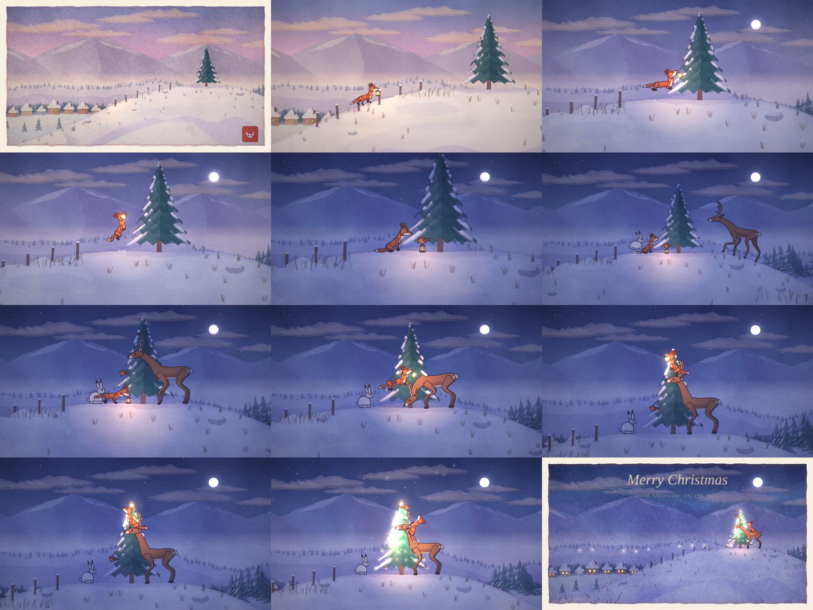

# One Small Light

A 30-second animated Christmas story about a fox kit, a lantern and a lonely fir tree. It plays live in the browser from **one HTML file**, and every note of its score moves something on screen.



## The story

| Bar | Time | What happens |
|---|---|---|
| 1 | 0–2.5 s | A blank watercolour sheet. Four chimes, four washes of paint: sky, hills, the hill, the fox. |
| 2 | 2.5–5 s | The sheet comes alive and snow begins. A fox kit carries a small lantern into the dusk. *One Small Light.* |
| 3–4 | 5–10 s | The climb. Every footstep crunches on the beat and leaves a print. The village below is lit; the fir on the hill is dark. |
| 5 | 10–12.5 s | Two hops to reach the top, each a note higher. A flop into the snow. |
| 6 | 12.5–15 s | The sad phrase. Ears down, the lantern flickers. A robin lands on it. |
| 7 | 15–17.5 s | Friends: a hare pops out of the snow, and a deer walks up the hill to sleigh bells. |
| 8 | 17.5–20 s | The deer lowers its head, the fox climbs on, and a rising arpeggio lifts them both. |
| 9 | 20–22.5 s | The lantern goes on the tip. Seven notes fall and light the tree one tier at a time. |
| 10 | 22.5–25 s | Bells open the stars and an aurora breathes in. |
| 11 | 25–27.5 s | Far away, other lights answer, one per note. *Merry Christmas.* |
| 12 | 27.5–30 s | It closes back into a painted sheet and the seal is stamped. Then it loops. |

## Watch it

Open `index.html` in a desktop browser and click once to begin with sound. `Space` pauses, `←` `→` jump a bar, `M` mutes and `R` restarts.

## How it is made

The approach follows [The Tea Ride](https://github.com/ChetasLua/the-tea-ride): plain JavaScript, GLSL shaders and [three.js](https://threejs.org) (r180, inlined). There are no image, font or sound files. Everything is drawn, painted and synthesised by code when the page loads, and the output is deterministic (the same time always gives the same frame).

- **Hand-painted backgrounds.** Each of seven paper layers is painted once in Canvas 2D. A wash is a glaze of 10–20 thin transparent layers of the same shape, with each edge pushed around by recursive midpoint displacement. The layers sit at different depths for parallax.
- **Hand-drawn characters.** The fox, deer, hare and robin are drawn like animation cels: inked outlines, flat colour, flat shadow. They are posed "on twos" (12 drawings a second) and the line "boils", so it trembles slightly each time it is redrawn.
- **Watercolour lens** (GLSL). This pass adds pigment pooling at the edges of washes, granulation in the paper's grain, slow turbulence in the wash, warm glow, cold-press paper texture, and the deckled border of the sheet.
- **Light.** A small light map from the lantern and the tree lights the snow and the animals.
- **One score.** `src/06_score.js` is read by both the synthesiser and the picture:

| Notes | What they move |
|---|---|
| Chimes, bar 1 | The four washes of paint |
| Footsteps | Prints in the snow |
| Pizzicato | The fox's hops, the hare's pop |
| Sleigh bells | The deer's steps |
| Cascade, bar 9 | The tree lights, one tier per note |
| High bells, bar 10 | Groups of stars |
| Music box, bar 11 | The far lights answering |

| File | What it makes |
|---|---|
| `00_util.js` | Maths, seeded randomness, easing, keyframes, the hill |
| `06_score.js` | The score and the queries the picture asks it |
| `10_paint.js` | The watercolour kit: washes, dabs, dry-brush strokes, mist |
| `16_story.js` | Camera moves, the fox's walk, time of day |
| `20_world.js` | The seven painted sheets: clouds, mountains, hills, village, ridge, hill and fir, foreground |
| `30_ink.js` | The cel kit: boiling ink lines, cel shading, limbs |
| `40_fox.js`, `42_deer.js`, `44_friends.js` | The fox kit, the deer, the hare, the robin, the lantern |
| `50_actors.js` | The choreography |
| `60_glow.js` | Moon, stars, aurora, tree lights, far lights, lantern, the light map |
| `70_titles.js` | Lettering and the seal |
| `80_post.js` | three.js stage, lighting, snow, glow and the watercolour lens |
| `85_audio.js` | Music box, strings, bass, bells, sleigh bells, snow crunch, robin, reverb, synthesised sample by sample in a Worker |
| `90_main.js` | Loader, player, frame-exact render mode |

## Build, render

```bash
python3 tools/build.py                   # src/ + three.js  ->  index.html
node tools/shots.mjs out/ 3 12 21 28     # stills at given seconds
node tools/audio.mjs sound.wav           # the soundtrack on its own
node tools/render.mjs film.mp4 24        # frame-exact MP4 with sound (needs ffmpeg + Playwright)
```

## Credits

[three.js](https://github.com/mrdoob/three.js), MIT licence (`vendor/LICENSE`). Approach inspired by The Tea Ride by ChetasLua.
