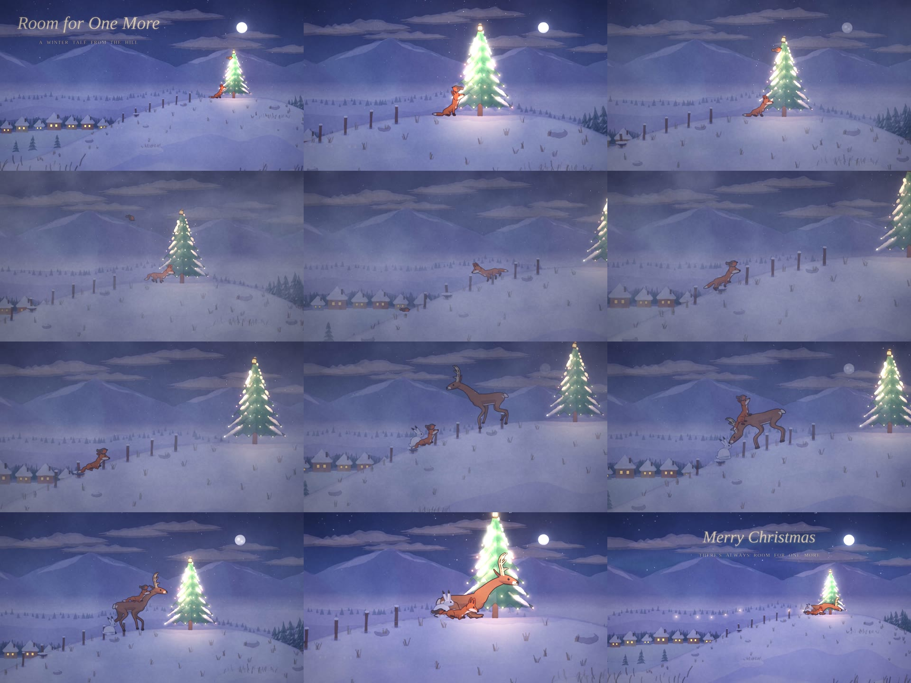

# Room for One More

A 60-second animated Christmas story set on the same hill as [One Small Light](../one-small-light). The lantern the fox hung is still on the tip of the fir. It plays live in the browser from **one HTML file**, and every note of its score moves something on screen.



## The story

**Act one: Christmas Eve** (0–17 s)

| Time | What happens |
|---|---|
| 0–5 s | A blank watercolour sheet; four chimes, four washes of paint. The tree on the hill glows. *Room for One More.* |
| 5–10 s | The robin sings from the top of the tree, flutters down to perch on the fox's head, and flies back up. |
| 10–15 s | The wind rises into a blizzard. A gust tears the robin off its branch and it tumbles away down the hill into the dark. |
| 15–17 s | The fox looks down into the storm, hesitates, and goes. |

**Act two: the storm** (17–45 s)

| Time | What happens |
|---|---|
| 17–23 s | The fox runs down the hill through the blizzard. |
| 23–25 s | It finds the robin half-buried in the snow, too cold to fly. The fox lowers its head, and the robin hops on. |
| 25–31 s | Back up the hill against the wind. The strongest gust pushes the fox back, and it collapses, exhausted. The tree is far away. |
| 33–37 s | The hare pops out of its burrow, and the deer walks down out of the snow to find them. |
| 37–41 s | The deer lowers its head. The fox climbs up its neck onto its back. |
| 41–46 s | *Cut.* The deer carries them home, the hare hopping in its tracks. The storm eases. |

**Act three: home** (46–60 s)

| Time | What happens |
|---|---|
| 46–51 s | The sky clears under the tree. The deer lies down. The fox hops off and curls up against it, the hare tucks in, and the robin hops into the curl of the fox's tail. |
| 52–55 s | The lantern glows brighter, the robin chirps, and one by one everyone falls asleep. |
| 55–60 s | Stars, an aurora, far lights answering. *Merry Christmas · there's always room for one more.* It closes into a painted sheet with its seal. |

## Watch it

Open `index.html` in a desktop browser and click once to begin with sound. `Space` pauses, `←` `→` jump a bar, `M` mutes and `R` restarts. A rendered video is in `room-for-one-more.mp4`.

## How it is made

It uses the same engine as *One Small Light*: plain JavaScript, GLSL and three.js, with no image, font or sound files.

- **Painted backgrounds:** seven watercolour layers painted in Canvas 2D.
- **Characters:** skeleton-driven, drawn as cels (one outline around each silhouette, a few inner lines).
- **Physics:** one simulation, stepped 240 times a second, moves everyone, with planted feet, gravity and springs.

New for this film:

- **Weather.** One storm curve drives everything:
  - how hard the wind blows on ears, tails, the swinging lantern and the robin
  - how much snow falls and how sideways it is driven
  - a veil of blown snow that hides how far away the tree is
  - the howl of the wind in the soundtrack
  - whether the moon and stars are visible
- **Rest poses.** The deer lies down with its legs folded under it. The fox lies down and curls its tail around the robin.
- **Riding and carrying.** The robin rides on the fox's head. The fox climbs the deer's neck as the deer lifts its head, then lies on the deer's back. A camera cut turns the deer for home.

## Build, render

```bash
python3 tools/build.py                   # src/ + three.js  ->  index.html
node tools/shots.mjs out/ 7.5 31.8 53    # stills at given seconds
node tools/audio.mjs sound.wav           # the soundtrack on its own
node tools/render.mjs film.mp4 30        # frame-exact MP4 with sound (needs ffmpeg + Playwright)
```

## Credits

[three.js](https://github.com/mrdoob/three.js), MIT licence (`vendor/LICENSE`). Approach inspired by The Tea Ride by ChetasLua.
